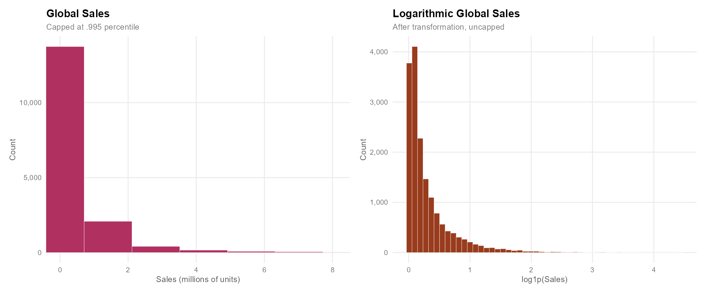
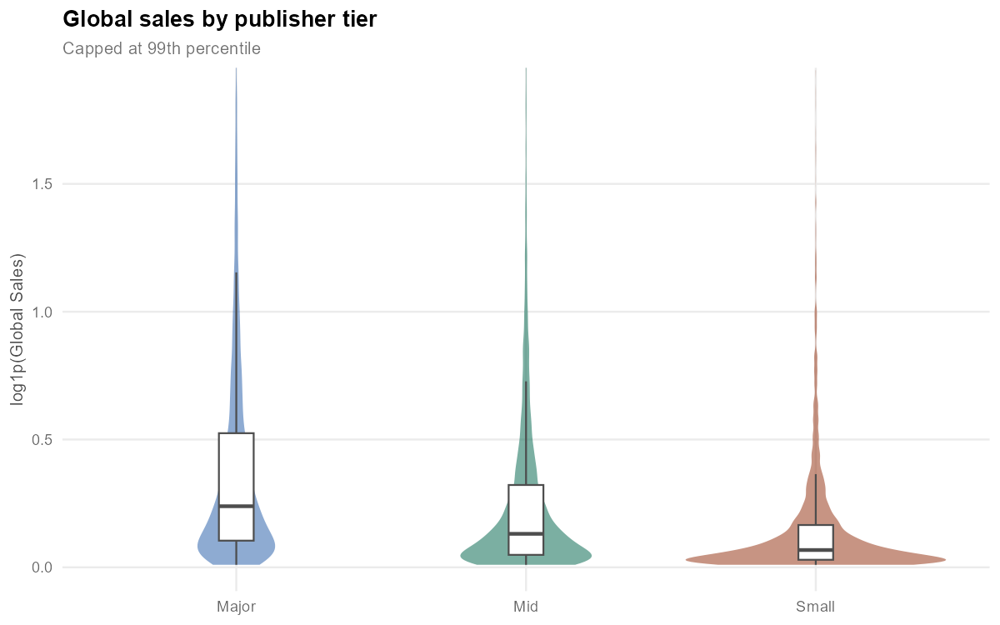
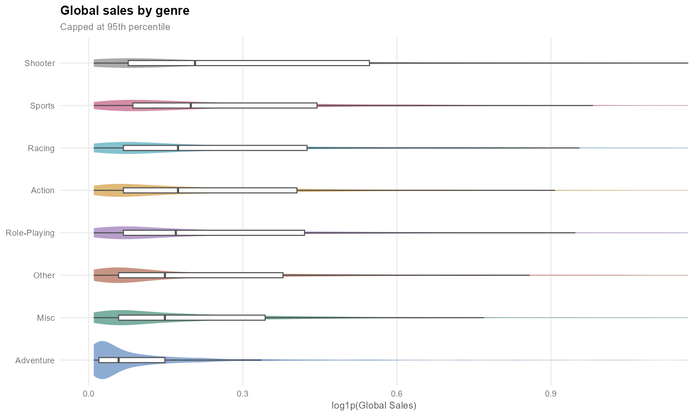
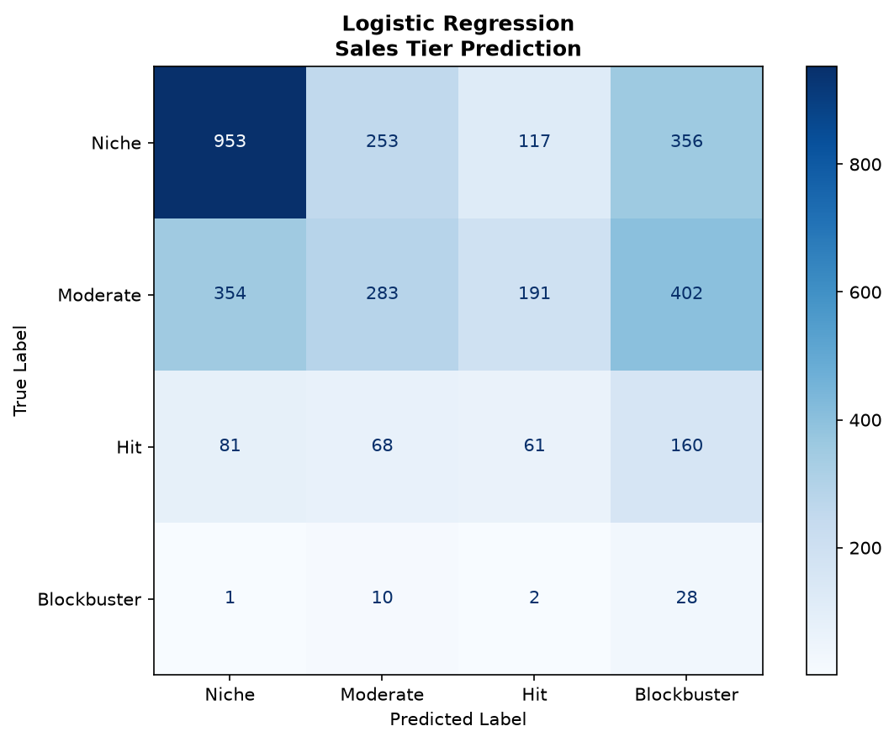

# What Drives Video Game Sales? A Statistical And Machine Learning Analysis

A study of 16,598 video games released between 1980 and 2016. It asks which characteristics of a game (its publisher, genre, platform generation and release decade) are associated with its commercial success, and how far those characteristics alone can predict that success.

## Project Overview

This project investigates whether the observable characteristics of a video game explain its sales. It combines inferential statistics to describe *whether* and *how much* sales differ across groups of games, with supervised machine learning, to measure *how predictable* a game's commercial outcome is from those same characteristics.

#### Research Questions

1. **RQ1.** Do global sales differ across publisher size, genre, console generation and release decade, and which of these factors has the strongest association with sales?
2. **RQ2.** Do regional markets behave differently? Specifically, do role-playing games sell a larger share of their units in Japan than other genres?
3. **RQ3.** Can a game's sales tier (Niche, Moderate, Hit, Blockbuster) be predicted from its publisher tier, genre, console generation and decade? Can its genre be predicted from the remaining attributes?

#### Main Idea

Video game sales follow an extremely right-skewed distribution: most games sell a few hundred thousand units, while a handful sell tens of millions. Because of this, comparisons based on means and normal-theory tests are unreliable. The analysis therefore relies on medians, non-parametric tests, bootstrap confidence intervals and log-transformed sales.

The raw attributes are high-cardinality: 578 publishers, 31 platforms and 12 genres. To make groups comparable and usable as model features, they are condensed into interpretable categories: publisher tier, console generation, genre group, decade and sales tier. The same engineered dataset feeds both the statistical study and the classifiers, so the two parts answer complementary questions about the same data.

### Dataset

This project uses the *Video Game Sales* dataset published on Kaggle (Smith, 2016), generated by scraping [VGChartz](https://www.vgchartz.com/). Each row is a game platform combination, with its release year, genre, publisher and sales in North America, Europe, Japan and the rest of the world, measured in **millions of units sold**.

Source: https://www.kaggle.com/datasets/gregorut/videogamesales

The engineered features added to the cleaned dataset are:

| Variable | Definition |
|---|---|
| `Decade` | 1980s, 1990s, 2000s, 2010s |
| `Genre_Group` | The 7 most frequent genres (Action, Sports, Misc, Role-Playing, Shooter, Adventure, Racing), plus `Other` |
| `Platform_Gen` | Console generation: Gen3-4, Gen5, Gen6, Gen7, Gen8, and `PC/Other` for PC and niche platforms |
| `Publisher_Tier` | Publishers ranked by number of games: Major (top 10), Mid (11–50), Small (rest) |
| `Sales_Tier` | Niche (≤ 0.17M, the median), Moderate (≤ 1M), Hit (≤ 5M), Blockbuster (> 5M) |
| `Log_*_Sales` | `log(1 + x)` of each sales variable |
| `*_Share` | Each region's share of global sales |

<details>
<summary><b>Platform abbreviations and generations</b></summary>

| Generation | Platforms |
|---|---|
| Gen3-4 | Atari 2600 (2600), NES, Super Nintendo (SNES), Game Boy (GB), Sega Genesis (GEN), Sega CD (SCD), Neo Geo (NG) |
| Gen5 | PlayStation (PS), Nintendo 64 (N64), Sega Saturn (SAT), 3DO |
| Gen6 | PlayStation 2 (PS2), Xbox (XB), GameCube (GC), Dreamcast (DC), Game Boy Advance (GBA) |
| Gen7 | PlayStation 3 (PS3), Xbox 360 (X360), Wii, Nintendo DS (DS), PlayStation Portable (PSP) |
| Gen8 | PlayStation 4 (PS4), Xbox One (XOne), Wii U (WiiU), Nintendo 3DS (3DS), PlayStation Vita (PSV) |
| PC/Other | PC, WonderSwan (WS), TurboGrafx-16 (TG16), PC-FX (PCFX), Game Gear (GG) |

</details>

## Methodology

#### Data Processing

Missing release years (271 games, 1.6%) are imputed with the median release year of the same platform, since games for a platform are released within a similar time window. Missing publishers (58 games) are labelled `Unknown`. No rows are removed.

#### Statistical Analysis

| Purpose | Method |
|---|---|
| Description | Central tendency, dispersion, skewness and kurtosis, stratified by each grouping |
| Interval estimation | Percentile bootstrap (1,000 resamples) for the median |
| Normality | Shapiro-Wilk on a random sample of 5,000 games |
| Group differences (RQ1) | Kruskal-Wallis, followed by Dunn post-hoc tests with Bonferroni correction |
| Regional differences (RQ2) | One-sided Mann-Whitney U test |
| Association | Spearman rank correlation |
| Explanatory models | Ordinary least squares on `log1p(Global_Sales)` and on `JP_Share` with categorical predictors |

#### Machine Learning

The data is split 80/20 with stratification, and hyperparameters are tuned with 5-fold `GridSearchCV` on the training set. Because the sales tiers are strongly imbalanced, every model is evaluated on accuracy, balanced accuracy and macro F1.

- **Decision Tree:** an unweighted tree selected by accuracy, and a class-weighted tree (`class_weight="balanced"`) selected by balanced accuracy.
- **Logistic Regression:** multinomial, class-weighted, on one-hot encoded features.
- **Categorical Naive Bayes:** predicts the genre group from decade, sales tier, platform generation and publisher tier.

## Results

#### RQ1: Factors associated with sales

All four groupings show statistically significant differences in global sales (Kruskal-Wallis, p < 2e-16). Dunn post-hoc tests find every pairwise difference significant for publisher tier, platform generation and decade. For genre, 8 of the 28 pairs are not significantly different (for example Action vs. Racing, and Sports vs. Shooter).

| Grouping | Kruskal-Wallis H | df | Highest median (M units) | Lowest median (M units) |
|---|---|---|---|---|
| Publisher tier | 1869.0 | 2 | Major: 0.27 | Small: 0.07 |
| Platform generation | 872.4 | 5 | Gen3-4: 0.48 | PC/Other: 0.045 |
| Genre group | 743.3 | 7 | Shooter: 0.23 | Adventure: 0.06 |
| Decade | 473.1 | 3 | 1980s: 0.80 | 2010s: 0.14 |

- **Publisher size is the strongest factor.** A game from one of the 10 largest publishers has a median of 0.27M units, almost four times the 0.07M of a small publisher.
- **Older decades show higher medians.** The early catalogue in the dataset contains mainly the games that were successful enough to be recorded.
- **Group membership explains little individual variation.** A linear regression of `log1p(Global_Sales)` on the four factors reaches only R² = 0.113.

#### RQ2: Regional markets

Role-playing games sell a significantly larger share of their units in Japan: a median of 42%, against 0% for all other genres (one-sided Mann-Whitney, p < 2e-16). A regression of `JP_Share` on genre and console generation (R² = 0.174) estimates Japan-share effects of +0.29 for Role-Playing and +0.34 for Adventure, relative to Action.

#### RQ3: Predictability

| Model (test set, n = 3,320) | Target | Accuracy | Balanced accuracy | Macro F1 |
|---|---|---|---|---|
| Decision Tree | Sales tier | 0.565 | 0.331 | 0.325 |
| Decision Tree, class-weighted | Sales tier | 0.396 | 0.406 | 0.300 |
| Logistic Regression, class-weighted | Sales tier | 0.399 | 0.411 | 0.287 |
| Categorical Naive Bayes | Genre group | 0.276 | 0.181 | 0.146 |

The unweighted tree reaches 56% accuracy by predicting the two dominant tiers and never predicts *Blockbuster*. Class weighting lowers accuracy to about 40% but raises Blockbuster recall from 0 to 0.54 (tree) and 0.68 (logistic regression). Genre is barely predictable from the other attributes: four of the eight genre groups are never predicted.

#### Conclusion

The publisher behind a game, its genre, its console generation and its release period are all significantly associated with its sales, and publisher size is the dominant factor. However, these factors describe *tendencies of groups*, not the outcome of individual games: they explain about 11% of the variance in log sales and support only weak classification of sales tiers.

| | |
|---|---|
|  |  |
|  |  |

## Project Structure

```
vgsales_analysis/
├── data/
│   ├── raw/vgsales.csv                 # Original Kaggle dataset
│   └── processed/vgsales_clean.csv     # Cleaned dataset with engineered features
├── statistics/
│   └── vgsales_stats.R                 # Cleaning, feature engineering and statistical analysis
├── machine_learning/
│   └── vgsales_ml.ipynb                # Decision Tree, Logistic Regression and Naive Bayes
├── figures/
│   ├── statistics/                     # Distribution, group comparison, correlation and regression plots
│   └── machine_learning/               # Decision tree and confusion matrices
├── results/
│   └── tables/                         # Statistical test results and descriptive tables (CSV)
├── reports/
│   └── machine_learning/               # Machine learning report (ACM LaTeX source and PDF)
├── requirements.txt
├── LICENSE
└── README.md
```

## Installation

Clone the repository:

```bash
git clone https://github.com/adlune/vgsales_analysis.git
cd vgsales_analysis
```

Install the R packages (tested with R 4.5.2):

```r
install.packages(c("tidyverse", "moments", "patchwork", "scales", "boot", "rstatix", "corrplot", "broom"))
```

Set up a Python virtual environment (tested with Python 3.13):

```bash
python -m venv .venv
source .venv/bin/activate        # macOS and Linux
source .venv/Scripts/activate    # Windows (Git Bash)
.venv\Scripts\Activate.ps1       # Windows (PowerShell)
pip install -r requirements.txt
```

The dataset is already included in `data/raw/`.

## Usage

Run the statistical analysis from the repository root. It writes the cleaned dataset, the statistical figures and the result tables:

```bash
Rscript statistics/vgsales_stats.R
```

Then run the machine learning notebook, which reads the cleaned dataset and writes the model figures:

```bash
jupyter nbconvert --to notebook --execute --inplace machine_learning/vgsales_ml.ipynb
```

## License

This project is licensed under the MIT License. See the [LICENSE](LICENSE) file for the full text.

To cite this project:

> Lara, A. (2026). *What Drives Video Game Sales? A Statistical and Machine Learning Analysis* [Source code and data]. GitHub. https://github.com/adlune/vgsales_analysis

## Contact Information

- **Author:** Adrian Lara
- **Contact:** contact@adrianlara.dev

## Acknowledgements

This project was developed as part of the *Descriptive and Inferential Statistics* and *Machine Learning* courses at the National Autonomous University of Mexico (UNAM), Morelia, Mexico.

Final review and project organization was assisted by AI Model Claude Code Opus 5.5 (Anthropic). All code and documentation were initially written by the author. AI assistance was used as a collaborative tool to support the learning and development process.

### Key References

1. Smith, G. (2016). *Video Game Sales* [Dataset]. Kaggle. https://www.kaggle.com/datasets/gregorut/videogamesales
2. Shapiro, S. S. and Wilk, M. B. (1965). "An analysis of variance test for normality (complete samples)." *Biometrika*, 52(3/4), 591-611.
3. Kruskal, W. H. and Wallis, W. A. (1952). "Use of ranks in one-criterion variance analysis." *Journal of the American Statistical Association*, 47(260), 583-621.
4. Dunn, O. J. (1964). "Multiple comparisons using rank sums." *Technometrics*, 6(3), 241-252.
5. Mann, H. B. and Whitney, D. R. (1947). "On a test of whether one of two random variables is stochastically larger than the other." *The Annals of Mathematical Statistics*, 18(1), 50-60.
6. Spearman, C. (1904). "The proof and measurement of association between two things." *The American Journal of Psychology*, 15(1), 72-101.
7. Efron, B. (1979). "Bootstrap methods: another look at the jackknife." *The Annals of Statistics*, 7(1), 1-26.
8. Breiman, L., Friedman, J., Olshen, R. and Stone, C. (1984). *Classification and Regression Trees*. Wadsworth.
9. He, H. and Garcia, E. A. (2009). "Learning from imbalanced data." *IEEE Transactions on Knowledge and Data Engineering*, 21(9), 1263-1284.
10. Pedregosa, F. et al. (2011). "Scikit-learn: Machine learning in Python." *Journal of Machine Learning Research*, 12, 2825-2830.
11. R Core Team (2025). *R: A Language and Environment for Statistical Computing*. R Foundation for Statistical Computing, Vienna, Austria.
